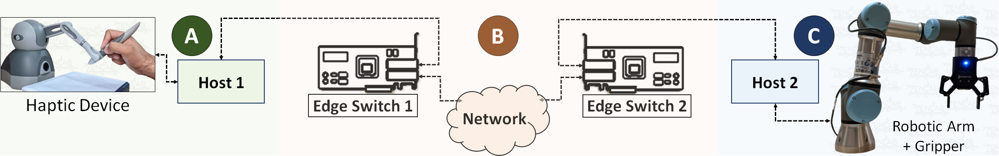

# EdgeP4: In-Network Edge Intelligence for a Tactile Cyber-Physical System Testbed Across Cities

* IEEE INFOCOM CNERT Workshop, 2024
* [Best paper award](media/BestPaperAward.jpg)  

## Authors
[Nithish K Gnani](https://github.com/nithishkgnani), [Joydeep Pal](https://github.com/joygetsit), [Deepak Choudhary](https://github.com/deepakc7y), Himanshu V, Soumya R, Kaushal M, T V Prabhakar, Chandramani Singh  

## Cyber-Pysical System Testbed



The devices run the code found in the following directories:  
1. Host 1: [Host1-Operator](Host1-Operator/) - Runs the code for Geomagic touch. Uses OpenHaptics and C programming.
2. Host 2: [Host2-Teleoperator](Host2-Teleoperator/) - Runs the code for UR3 root. Uses ROS 1 and Python
3. Edge Switch 1: [Tremor_Reduction](Tremor_Reduction/) - Runs the code to eliminate packets linked to unintenetional hand tremors. Uses P4 for SmartNIC.
4. Edge Switch 2: [Pose_Correction](Pose_Correction) - Runs the code to perform automatic grip inspection and pose correction while holding a tool. Uses P4 for SmartNIC.

### Connection on the SmartNIC

Connect Geomagic Touch on one of the ports of the SmartNIC and UR3 on the other port. Update the match action json file accordingly.

## Communication Setup

Go to the relevant folder for wither pose correction or tremor suppression and execute the commands in the following order:

* On the host system of the SmartNIC `cd Pose_Correction/` or `Tremor_Reduction/`  

```bash
sudo bash
./EdgeP4_start.sh  
./EdgeP4_load.sh
```

* On the UR3 system (Host2-Teleoperator)  

```bash
sudo bash
cd Host2-Teleoperator/
ip addr add 10.0.0.2/24 dev enp1s0f1
./arp_fix.sh
```

* On the GeoMagic Touch system (Host1-Operator)

```bash
sudo bash
cd Host1-Operator/
ip addr add 10.0.0.1/24 dev enp1s0f0
./arp_fix.sh
```

* To stop and unload the P4 program, run the following command on the SmartNIC host system  

```bash
./EdgeP4_stop.sh
```

## Teleoperator Robot Side (UR3)

* Install the Universal Robots ROS driver by following the instructions [here](https://github.com/UniversalRobots/Universal_Robots_ROS_Driver).

* Paste the relevant script file (513_2DGrip_10FSR_DummyVals) in the Universal_Robots_ROS_Driver/ur_robot_driver/scripts/ folder of the UR ROS driver.

* Run the UR3 side (Host2-Teleoperator) on separate terminals:

```bash
roscore
roslaunch ur_robot_driver ur3_bringup.launch robot_ip:=xx.yy.zz.aa #replace with the IP of the UR3
roslaunch ur_robot_driver example_rviz.launch #optional
rosrun ur_robot_driver test_move
```

* If you build the force sensor array, read the force values using PySerial library and replace the dummy values in the script file.

## Operator Haptic Device (Geomagic Touch)

* Install the OpenHaptics SDK by following the instructions [here](https://support.3dsystems.com/s/article/OpenHaptics-for-Linux-Developer-Edition-v34?language=en_US).

* Initialize the device by running the Touch Setup and Touch Diagnostics that come with the SDK.

* Now, run the Operator side (Host1-Operator):

```bash
make
./Operator
```

* Type `q` to quit the program
* The terminal display will beblank as the OpenHaptics toolkit has some issue. You can resset the terminal or type future commands without looking at the terminal display.

* To clean the files, run `make clean`.